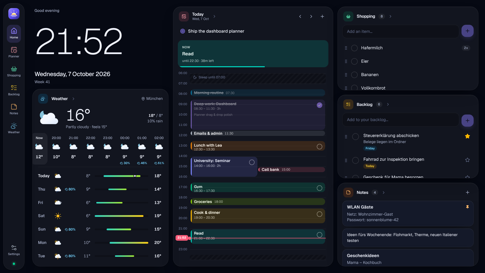

# Smart Assistant

A private, self-built home dashboard for a wall-mounted touch screen (Raspberry Pi 5), the phone and the
laptop – always in sync.

- **Day planner** – rough time blocks for the day, greyed-out sleep times per weekday, tap to add,
  press-and-hold to move, drag to resize, mark done, copy days, "focus of the day", plan items straight
  from the backlog. Swipe between days, month calendar to jump to any date; the home screen card
  browses the next days too.
- **Weather** – current conditions, hourly curve, 7-day forecast with temperature ranges; tap a day for
  its hours. UV, wind, sunrise/sunset, air quality and pollen. Free Open-Meteo data.
- **Shopping list** – add, tick off, swipe to delete, undo, drag to reorder, one-tap suggestions from what
  you buy often.
- **Backlog** – longer to-dos as free text (first line is the headline), stars, due dates, drag to reorder.
- **Notes** – Keep-style quick notes with an optional title, pin to the top, press and hold to reorder.
- **Clock & date** in English with German order ("Tuesday, 6 October 2026 · 13:10 · Week 41").
- **Wall display mode** – built-in German on-screen keyboard, night mode with a dim clock, auto-update
  after deploys, screen wake lock, no cursor, finger scrolling even when the touch screen reports itself
  as a mouse.
- **Installable PWA** for the phone with app-like back navigation (sheets close on "back", sections go
  back to home), light/dark/auto (sunset) theme, offline-first cache.



## Stack

| Layer | Choice |
| --- | --- |
| App | Next.js 16 (App Router, `proxy.ts`), React 19, TypeScript, Tailwind CSS 4, Motion |
| Data | Supabase Postgres + Row Level Security, Realtime (postgres_changes), Auth (e-mail code, passkeys, Google) |
| Client state | TanStack Query (optimistic updates, persisted cache) |
| Hosting | Vercel (Hobby) + daily keep-alive cron |
| Weather | Open-Meteo (forecast, geocoding, air quality) |
| Tests | Vitest (unit + database security), Playwright (end-to-end) |

## How it fits together

```
Browser / wall display / phone PWA
   │  HTML, JS (CSP with nonce)            │ data (RLS, user JWT)        │ weather
   ▼                                       ▼                             ▼
Vercel ── proxy.ts: session refresh,  Supabase: Postgres + Auth +     Open-Meteo
          login redirect, allowlist   Realtime (changes stream back)
```

Data is read and written directly from the browser with the user's JWT; Postgres RLS enforces that
every row belongs to the signed-in user. No secret keys exist in the app.

## Getting started

- **Production setup (German, step by step):** [docs/SETUP.md](docs/SETUP.md)
- **Local development:**

  ```bash
  npm install
  npx supabase start            # local Supabase in Docker
  cp .env.example .env.local
  node scripts/seed-demo.mjs    # optional demo data for dev@example.com
  npm run dev
  ```

| Command | What it does |
| --- | --- |
| `npm run dev` / `build` / `start` | Next.js |
| `npm run lint`, `npm run typecheck` | ESLint, TypeScript |
| `npm test` | Unit tests |
| `npm run test:integration` | Database security tests (needs local Supabase) |
| `npx playwright test` | End-to-end tests (needs local Supabase + `npm run build`) |
| `npm run db:types` | Regenerate `src/lib/database.types.ts` from the local database |

## Project layout

```
src/app/(app)/        signed-in pages: dashboard, planner, shopping, todos, weather, settings
src/app/login/        sign-in (e-mail code, passkey, Google)
src/proxy.ts          CSP nonce + Supabase session + auth gate
src/components/       UI by feature (planner, shopping, todos, weather, kiosk, shell, ui)
src/data/             TanStack Query hooks with optimistic updates
src/lib/              dates (de-DE), sleep schedule, planner layout, weather client, security
supabase/migrations/  schema, RLS, grants, realtime, sign-up allowlist hook
public/kiosk/setup.sh Raspberry Pi kiosk installer
tests/, e2e/          integration and end-to-end tests
```
