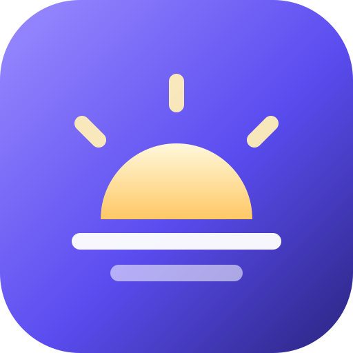
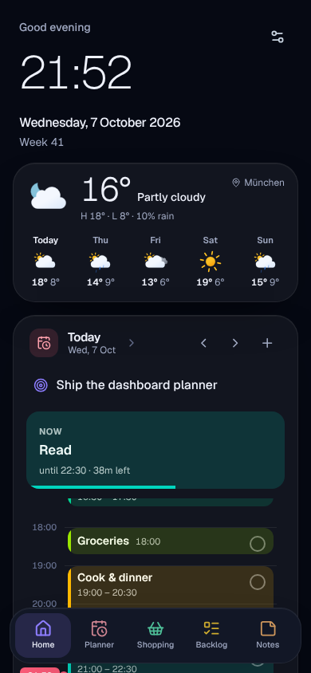
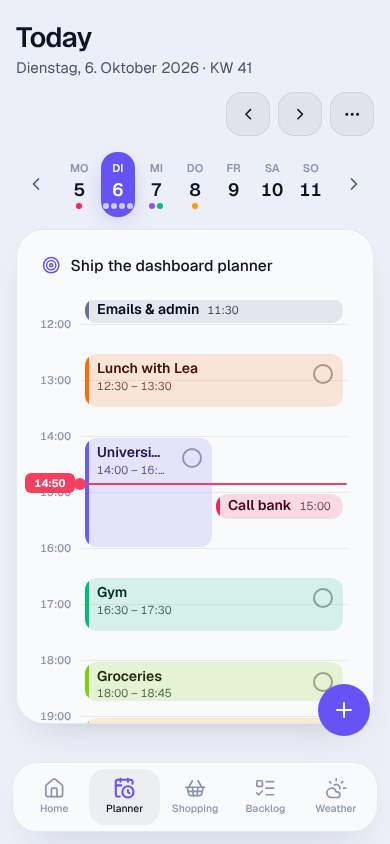
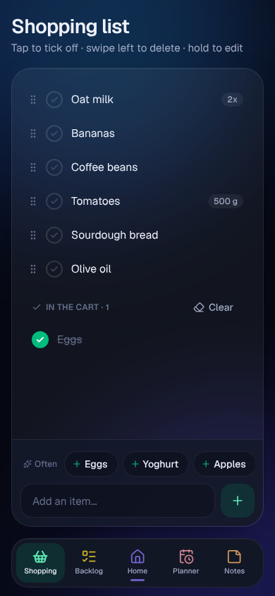
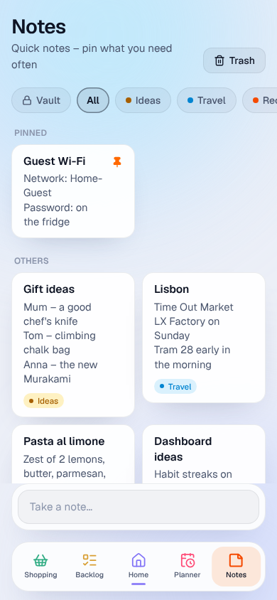
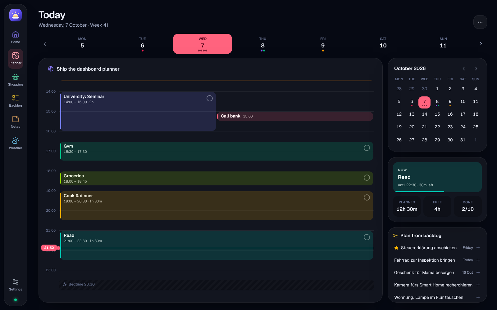
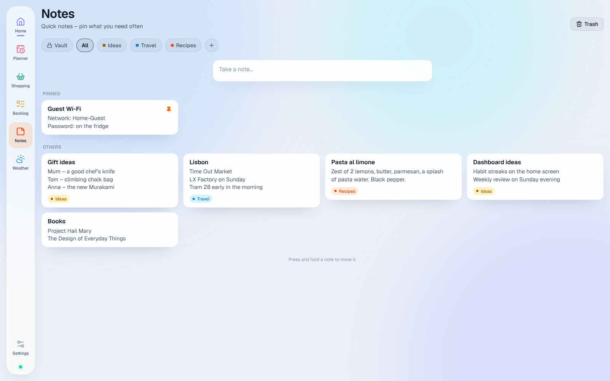
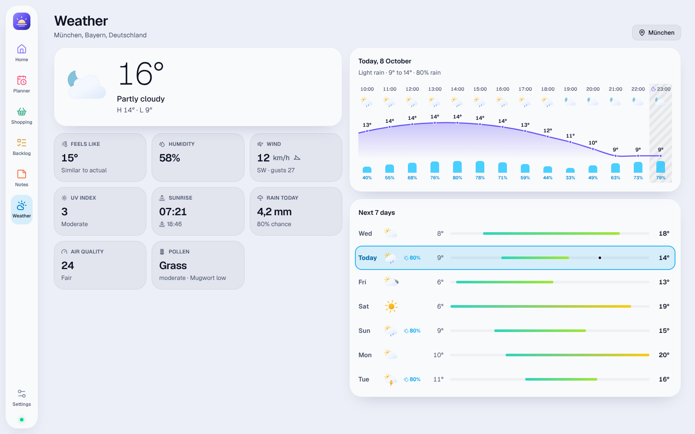
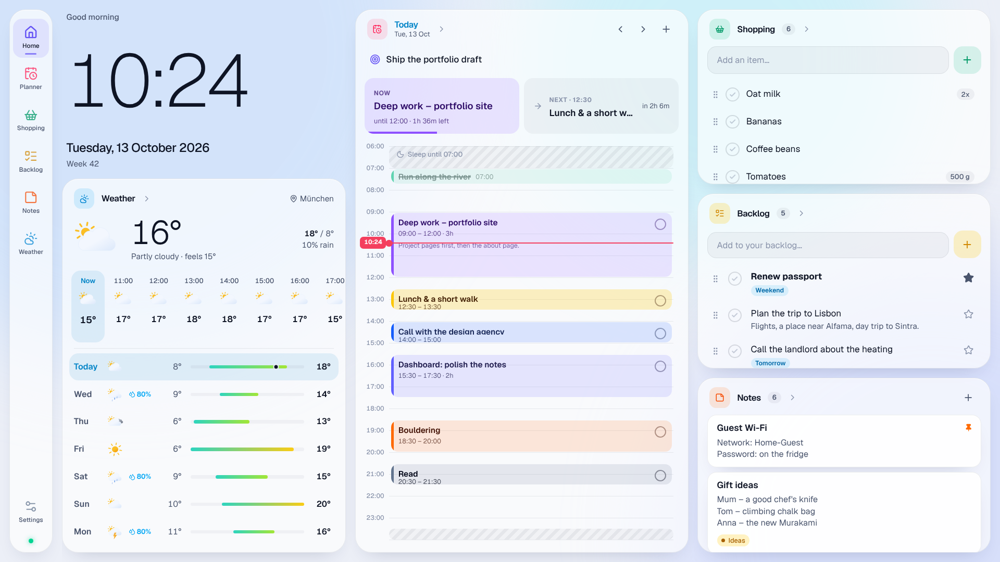

<div align="center">



# Smart Assistant

**One personal dashboard for my day – on the wall, on my phone, on my laptop.**

Planner, backlog, shopping list, notes and weather in one place, built exactly the way I use them.


</div>

## Why I built it

The small things I need every day lived in too many places: a calendar app for the day, another app for
to-dos, a shopping list somewhere else, notes in yet another tool and the weather in a widget. Each one
looked and worked differently on the phone and on the computer, and none of them matched how I actually
plan my day. Either a tool did far too much and I used 10 % of it, or it was missing the one feature I
wanted.

So I built my own: **one dashboard that shows what matters today, works the same everywhere and does
exactly what I need – nothing more.** It's a personal project I use every day and keep developing.

## One dashboard, three screens

| | |
| --- | --- |
| 🖼️ **Wall display** | A Raspberry Pi 5 with a large touch screen at home runs the dashboard in kiosk mode. In the morning I see the time, the weather, my plan, what's left to buy and what's on the backlog at a glance. It has its own on-screen keyboard, a dim night mode and updates itself after every deploy. |
| 📱 **Phone** | The same dashboard is my **Android home screen**: a small Kotlin launcher app wraps it, lists and searches my apps, shows the ones I used last and can block apps I don't want to open. It updates itself from the dashboard. |
| 💻 **Laptop** | A responsive web app (also installable as a PWA) – sign in with a passkey and everything is there. |

Everything syncs live between the devices: tick something off on the phone and it disappears from the
wall a moment later.

<table>
  <tr>
    <td></td>
    <td></td>
    <td></td>
    <td></td>
  </tr>
</table>

## What it does

- **Day planner** – rough time blocks instead of exact appointments. Sleep times per weekday are greyed
  out, "now" and "next" are always in view, and blocks can be moved, resized and ticked off by touch. A
  month calendar shows German public holidays (with whether the shops are open), birthdays and the clock
  change.
- **Backlog** – longer to-dos as free text, with stars and due dates. One tap plans an item into the
  day; ticking it off in either place ticks it off in both.
- **Shopping list** – fast to fill, with one-tap suggestions from what I buy often.
- **Notes** – Keep-style notes with coloured categories, pinning, a trash, and a **vault** whose notes
  only open with a PIN.
- **Weather** – the current conditions, hourly curve, 7-day forecast, UV, air quality and pollen.
- **Six designs** (Aurora, Aurora Sky, Studio, Tactile, Block, Doodle), each in light and dark, chosen per device.

<table>
  <tr>
    <td width="50%"></td>
    <td width="50%"></td>
  </tr>
  <tr>
    <td width="50%"></td>
    <td width="50%"></td>
  </tr>
</table>

## How it's built

```
 Wall display (Pi, Chromium kiosk) ─┐
 Phone (Android launcher, WebView) ─┼─▶  Next.js on Vercel  ──▶  Supabase
 Laptop (browser / PWA) ────────────┘    proxy: session,          Postgres + Row Level Security
                                         sign-in gate, CSP        Auth (e-mail code, passkeys)
                     ◀──────────── live changes ───────────────   Realtime
```

| Layer | Choice |
| --- | --- |
| App | Next.js 16 (App Router), React 19, TypeScript, Tailwind CSS 4, Motion |
| Data | Supabase: Postgres with Row Level Security, Realtime, Auth with e-mail codes and passkeys |
| Client state | TanStack Query with optimistic updates and an offline cache |
| Phone | Kotlin launcher app (WebView + a small message bridge), built and signed in GitHub Actions |
| Wall display | Raspberry Pi 5, Chromium in kiosk mode, set up by one script |
| Hosting | Vercel, with a daily keep-alive cron |
| Weather | Open-Meteo (forecast, geocoding, air quality) |
| Tests | Vitest (unit and database security), Playwright (end-to-end), all in CI |

**A few things I cared about:**

- **Security in the database, not in the UI.** The browser talks to Postgres directly with the user's
  token, and Row Level Security decides what it may see. Integration tests try to read and change another
  user's data in every table. There are no secret keys in the app.
- **The notes vault is enforced by Postgres.** The PIN is stored as a bcrypt hash; unlocking returns a
  short-lived token, and the notes' access rules only let vault notes through with it. Repeated wrong
  PINs lock it with a growing wait. Vault notes are never kept in the offline cache.
- **Instant everywhere.** Every change shows up immediately (optimistic updates) and is synced to the
  other devices through Realtime.
- **Made for touch.** Press-and-hold to move, swipe between days and categories, a German on-screen
  keyboard on the wall – and a fix for touch screens that report themselves as a mouse.
- **A phone launcher that updates itself.** Every change to the Android app is built, signed and
  published by CI; the launcher notices the new version and installs it in one tap.
- **Tested end to end.** About 60 Playwright scenarios run against a local Supabase on every push,
  including touch gestures and the launcher bridge.

## Running it locally

```bash
npm install
npx supabase start            # local Supabase in Docker
cp .env.example .env.local
node scripts/seed-demo.mjs    # demo content for dev@example.com (the code arrives in Mailpit)
npm run dev
```

| Command | What it does |
| --- | --- |
| `npm run dev` / `build` / `start` | Next.js |
| `npm run lint`, `npm run typecheck` | ESLint, TypeScript |
| `npm test` | Unit tests |
| `npm run test:integration` | Database security tests (needs local Supabase) |
| `npx playwright test` | End-to-end tests (needs local Supabase and `npm run build`) |
| `npm run db:types` | Regenerate `src/lib/database.types.ts` from the local database |

More detail: [production setup](docs/SETUP.md) (Supabase, Vercel, Raspberry Pi; in German) and
[the Android launcher](docs/LAUNCHER.md).

## Project layout

```
src/app/              pages: dashboard, planner, shopping, backlog, notes, weather, settings, sign-in
src/components/       UI by feature (planner, notes, launcher, kiosk, shell, ui …)
src/data/             TanStack Query hooks with optimistic updates
src/lib/              dates, sleep schedule, planner layout, weather, security, launcher bridge
src/proxy.ts          CSP nonce, Supabase session, sign-in gate
supabase/migrations/  schema, Row Level Security, grants, realtime
android/              the Kotlin launcher app
public/kiosk/         Raspberry Pi kiosk installer
tests/, e2e/          database security and end-to-end tests
```

---

A personal project by [@simonroedig](https://github.com/simonroedig). The code is public to show how it's
built; it's made for one user and isn't meant as a ready-to-run product.
